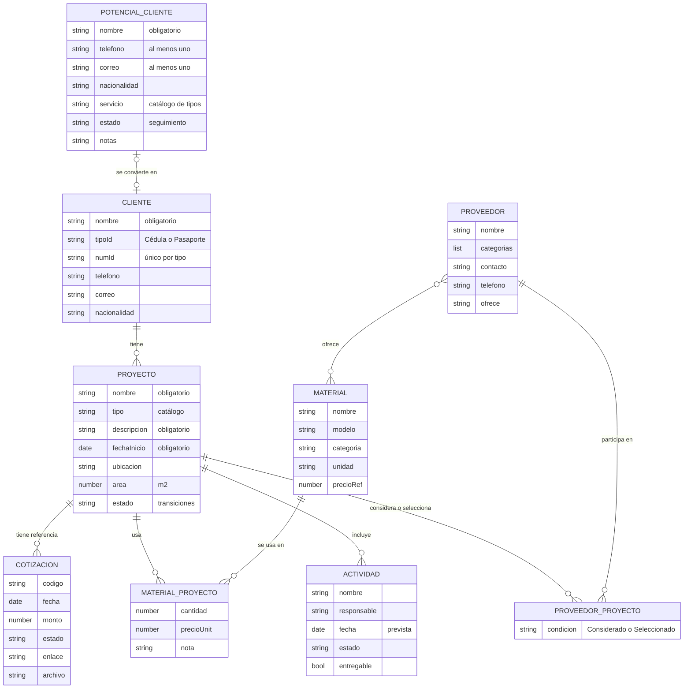
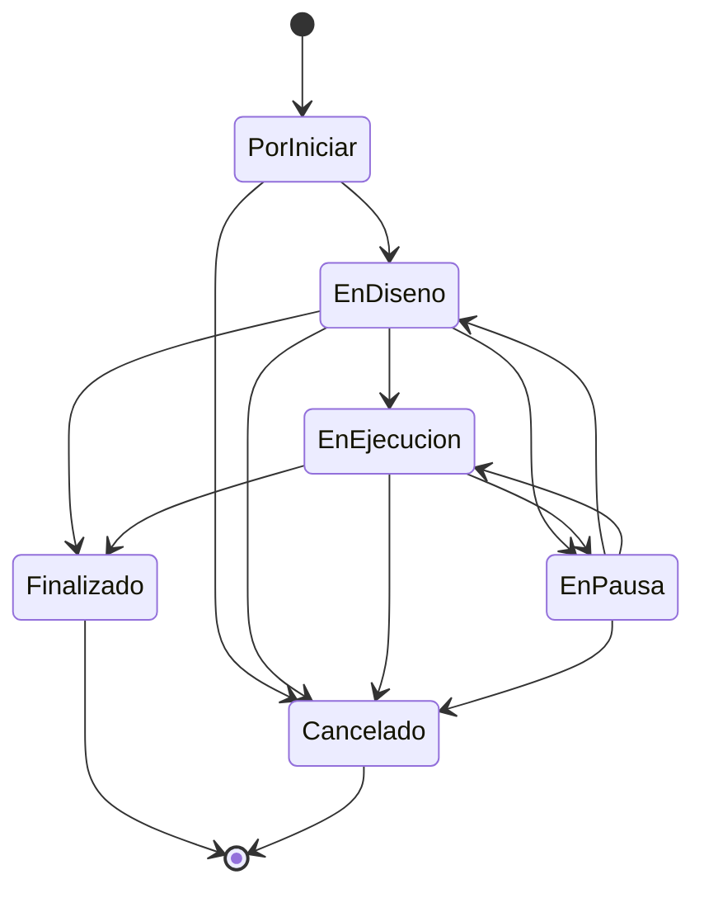

# 3. Modelo de datos

Entidades y relaciones que usa el prototipo (`prototipo/js/app.js`, función `seed()`). El modelo es conceptual: describe **qué** información se guarda, no **cómo** se guardaría en una base de datos definitiva.

## Diagrama entidad-relación

**Cómo leer las relaciones:** `||--o{` significa «uno a cero o muchos». Por ejemplo, un cliente tiene cero o muchos proyectos, y cada proyecto pertenece exactamente a un cliente (RN-01).

## Diagrama de estados del proyecto (RF-08)

Todo proyecto nuevo inicia en **Por iniciar**. **Finalizado** y **Cancelado** son estados finales. Las transiciones son una **propuesta del equipo** y deben validarse con Anémona (ver supuestos).

## Catálogos

| Catálogo | Valores |
|---|---|
| Tipos de servicio (RF-07) | Anteproyecto, Diseño de interiores, Mobiliario a medida, Remodelación, Gestión de construcción (de la minuta) |
| Estados de seguimiento de potenciales clientes | Nuevo, Contactado, Reunión agendada, Cotización enviada, No continuó |
| Estados de actividad | Pendiente, En proceso, Completada |
| Categorías de proveedor | Iluminación, Mobiliario, Ebanistería, Construcción, Acabados, Materiales, Electrodomésticos, Otros servicios |
| Responsables | Gabriela Núñez, María José, Colaborador externo |
