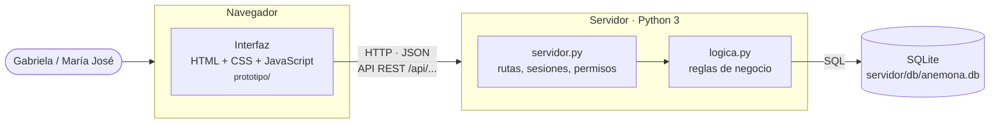

# 8. Arquitectura del prototipo

## Vista general

El prototipo sigue una arquitectura **cliente-servidor en tres capas**:

| Capa | Archivo | Responsabilidad |
|---|---|---|
| Presentación | `prototipo/index.html`, `css/styles.css`, `js/app.js` | Mostrar pantallas y validar formatos al momento: campos obligatorios, correo, teléfono, cédula. Así el usuario recibe respuesta inmediata (RNF-01, RNF-04). |
| Aplicación | `servidor/servidor.py` | Recibir las peticiones HTTP, verificar la sesión y el permiso del rol (RF-17), y devolver JSON. |
| Lógica de negocio | `servidor/logica.py` | Aplicar **todas** las reglas del ERS: duplicados, identificación única, transiciones de estado, cliente obligatorio, etc. |
| Datos | `servidor/db/esquema.sql` | Tablas con llaves foráneas, campos únicos y restricciones `CHECK`, como última defensa de la integridad (RNF-02). |

**¿Por qué validar en tres lugares?** La interfaz valida para que la experiencia sea buena, pero cualquiera puede saltársela, por ejemplo enviando una petición directa. Por eso el servidor vuelve a validar todo, y la base de datos impide guardar datos inconsistentes aunque haya un error en el código. Las pruebas `pruebas_api.py` comprueban las dos últimas capas sin usar la interfaz.

## Dos modos de ejecución

| Modo | Cómo se abre | Dónde se guardan los datos | Uso |
|---|---|---|---|
| **Servidor** | `python servidor/servidor.py` → http://localhost:8000 | Base de datos SQLite, compartida | Uso real del prototipo y presentación |
| **Demostración** | Doble clic en `prototipo/index.html`, o GitHub Pages | `localStorage` del navegador | Enviar un enlace para mirarlo rápido, sin instalar nada |

La interfaz detecta sola el modo: consulta `/api/salud` y, si responde, trabaja contra la API. En `app.js`, todas las modificaciones pasan por `op(nombre, datos)`, que tiene dos implementaciones de las mismas operaciones: llamar a la API o aplicar la regla en el navegador. Las pruebas de aceptación se ejecutan en ambos modos para asegurar que se comportan igual.

## API REST

Todas las rutas, salvo `/api/salud` y `POST /api/sesion`, requieren una sesión iniciada. Las que modifican datos requieren además un rol con permiso de edición.

| Método | Ruta | RF | Descripción |
|---|---|---|---|
| GET | `/api/salud` | — | Verifica que el servidor y la base respondan |
| POST | `/api/sesion` | RF-17 | Inicia sesión `{usuario, clave}` y devuelve una cookie de sesión |
| GET | `/api/sesion` | RF-17 | Usuario de la sesión actual |
| DELETE | `/api/sesion` | RF-17 | Cierra la sesión |
| GET | `/api/datos` | RF-02, 04, 06, 15 | Todos los registros y los catálogos (tipos, estados, transiciones, plan) |
| POST / PUT | `/api/potenciales[/{id}]` | RF-01, RF-02 | Registrar o actualizar un potencial cliente |
| POST | `/api/potenciales/{id}/convertir` | RF-03 | Convertir en cliente |
| POST / PUT | `/api/clientes[/{id}]` | RF-04 | Registrar o actualizar un cliente |
| POST / PUT | `/api/proyectos[/{id}]` | RF-05 a RF-07 | Registrar o actualizar un proyecto (`plan: true` carga el plan de acción) |
| PUT | `/api/proyectos/{id}/estado` | RF-08 | Cambiar el estado (valida la transición) |
| POST | `/api/proyectos/{id}/plan` | RF-13 | Cargar el plan de acción del tipo de servicio |
| POST | `/api/proyectos/{id}/proveedores` | RF-11 | Asociar proveedores con su condición |
| PUT / DELETE | `/api/proyecto-proveedores/{id}` | RF-11 | Cambiar la condición o quitar la asociación |
| POST | `/api/proyectos/{id}/materiales` | RF-12 | Asociar un material, con cantidad y precio |
| PUT / DELETE | `/api/proyecto-materiales/{id}` | RF-12 | Editar o quitar el material del proyecto |
| POST / PUT | `/api/actividades[/{id}]` | RF-13, RF-14 | Registrar o actualizar una actividad |
| POST / PUT | `/api/proveedores[/{id}]` | RF-09 | Registrar o actualizar un proveedor |
| POST / PUT | `/api/materiales[/{id}]` | RF-10 | Registrar o actualizar un material |
| POST / PUT | `/api/cotizaciones[/{id}]` | RF-16 | Registrar la referencia, con documento adjunto opcional en base64 |
| GET | `/api/cotizaciones/{id}/archivo` | RF-16 | Descargar el documento adjunto |
| POST | `/api/reiniciar` | — | Vuelve a cargar los datos de ejemplo (para presentaciones) |

### Respuestas

| Código | Significado | Cuerpo |
|---|---|---|
| 200 / 201 | Correcto / creado | `{ "id": "..." }` |
| 400 | Datos inválidos o regla incumplida | `{ "mensaje": "...", "errores": { "campo": "mensaje" } }`. La interfaz marca cada campo con su mensaje (RNF-04). |
| 401 | No hay sesión | `{ "mensaje": "Debe iniciar sesión." }` |
| 403 | El rol no tiene permiso | `{ "mensaje": "Acción no autorizada para su rol..." }` |
| 404 | Registro inexistente | `{ "mensaje": "Registro no encontrado." }` |

## Seguridad (RF-17, RNF-03)

- **Contraseñas cifradas** con PBKDF2-SHA256 (120 000 iteraciones), cada una con su propia sal. La base nunca guarda la contraseña.
- **Sesiones** con un token aleatorio de 256 bits, guardado en la tabla `sesion`, que vence a las 8 horas.
- **Cookie de sesión** `HttpOnly` y `SameSite=Strict`: JavaScript no puede leerla y no se envía desde otros sitios.
- **Permisos en el servidor:** el rol «consulta» recibe 403 en cualquier modificación, aunque use la API directamente (prueba PA-31).
- **Archivos estáticos:** el servidor solo entrega archivos dentro de `prototipo/`; no se puede leer el código ni la base desde el navegador.
- **Documentos adjuntos:** máximo 10 MB y solo PDF, PNG, JPG o DOCX.
- **Consultas SQL parametrizadas** en todas las operaciones, para evitar inyección SQL.

## Base de datos

El esquema completo está en [`servidor/db/esquema.sql`](../servidor/db/esquema.sql) y el diagrama en [`03-modelo-de-datos.md`](03-modelo-de-datos.md). Puntos clave:

- **Catálogos como tablas:** `tipo_servicio`, `estado_proyecto`, `transicion_estado`, `categoria` y `plan_actividad`. Si Gabriela cambia un estado o un plan de acción, se modifica una fila y no el código.
- **Integridad referencial:** `proyecto.cliente_id` es una llave foránea con `ON DELETE RESTRICT`, así que no puede haber proyectos sin cliente (RN-01, RNF-02).
- **Unicidad:** `UNIQUE (tipo_id, num_id_normal)` en clientes, con la identificación normalizada sin guiones ni espacios.
- **Restricciones `CHECK`:** valores permitidos de cada estado, cantidades positivas, al menos un medio de contacto y una cotización con enlace o documento.

Para explorar la base se puede usar [DB Browser for SQLite](https://sqlitebrowser.org/), que es gratuito: se abre el archivo `servidor/db/anemona.db`.
